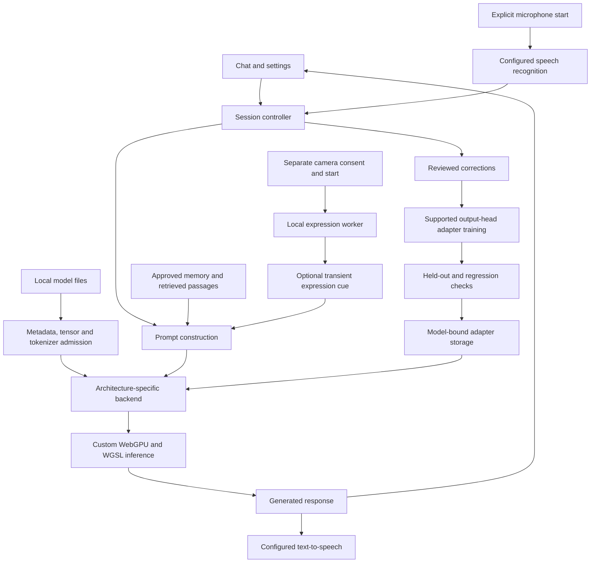
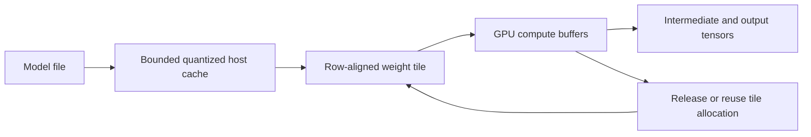
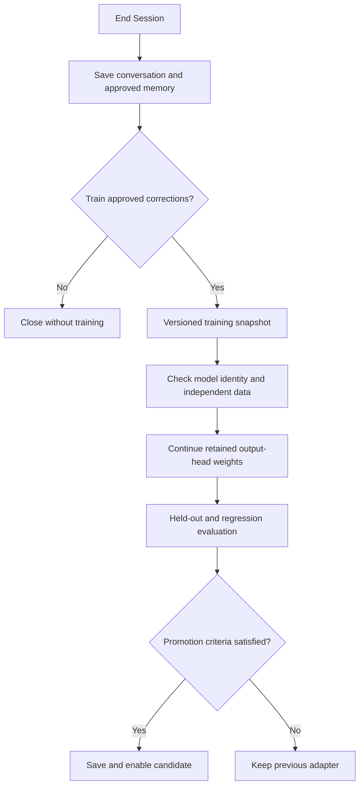
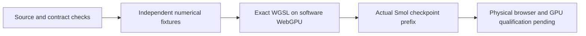

# Nexus AI Studio

### Local-first AI • Custom WebGPU inference • Memory • Voice • Reviewed learning

**Nexus Emerging Technology · Richard Dunbar**

**Release status:** Experimental research preview, 9 October 2026.

Nexus AI Studio is a browser-based workspace for running supported local language models, managing conversational knowledge, reviewing corrections, experimenting with model-specific output-head adapters, and interacting through text and voice. An optional, separately controlled facial-expression module provides tentative visual cues for local conversation.

The application combines a custom JavaScript/WGSL inference engine with architecture-specific model admission, local persistence, bounded memory policies and explicit evaluation gates. It is designed to make local AI inspectable and customizable while preserving clear distinctions between implemented functionality, numerical evidence and hardware qualification.

> This release has passed its recorded software and packaging checks. It has not been qualified on a physical Radeon, in a live browser, or with real microphone/camera interaction. No claim of universal GGUF support, production readiness, state-of-the-art accuracy or benchmark parity is made.

## Contents

1. [Development approach](#development-approach)
2. [Release artifacts](#release-artifacts)
3. [System architecture](#system-architecture)
4. [Model support](#model-support)
5. [Inference and memory](#inference-and-memory)
6. [Memory and learning](#memory-and-learning)
7. [Voice and expression](#voice-and-expression)
8. [Validation and numerical results](#validation-and-numerical-results)
9. [Installation and reproducibility](#installation-and-reproducibility)
10. [Privacy and operational boundaries](#privacy-and-operational-boundaries)
11. [Attributions and research](#attributions-and-research)

## Development approach

Nexus AI Studio was developed by Richard Dunbar using AI-assisted coding. AI tools supported implementation, debugging, code review and documentation, helping him explore complex ideas and reduce repetitive coding work. Richard directed the project, made design and integration decisions, and remained responsible for deciding which changes to keep.

For this project, the single-file application supports that workflow. Keeping the interface, state management and runtime logic together helps Richard give AI tools a coherent view of the application and trace how changes affect interconnected features. This reflects the way he works on Nexus; the best structure for another project will depend on its needs and development tools.

The application has been shaped through hundreds of **build–measure–learn iterations**, with feedback from end users informing what to change and where to focus next. The process is to build a change, measure and review its behavior, learn from the results and user feedback, and use those findings to guide the next revision.

AI-generated code still requires human review, testing and validation. The checks, numerical results and qualification limits recorded in this README remain the basis for assessing this release.

## Release artifacts

Language-model weights are supplied separately. The application does not include or automatically download a large language model.

| Artifact | Exact bytes | Decimal MB | Purpose |
|---|---:|---:|---|
| `NexusAI.html` | 4,084,777 | 4.085 | Standalone application code |
| `NexusAI_Offline_App.zip` | 9,872,826 | 9.873 | Application, expression assets, documentation and notices |
| `NexusAI_Source_QA.zip` | 26,534,809 | 26.535 | Companion source, tests and recorded evidence |

### Distribution-size chart

Each full block represents approximately 1 MB. These are distribution sizes, not runtime RAM or VRAM consumption. The archives overlap in content and must not be added together as an installed-memory estimate.

```text
HTML             ████                         4.085 MB
Complete app ZIP ██████████                   9.873 MB
Source / QA ZIP  ███████████████████████████ 26.535 MB
```

### Artifact identity

```text
NexusAI.html
SHA-256: d1d45f1825852cfb20b80a868101820cdb89f504d8eeff707bed8c797177db93

NexusAI_Offline_App.zip
SHA-256: bde849706a11b89d095f9645c8ab26747dd7f772bdcd6199fbbbd86584a5033c

NexusAI_Source_QA.zip
SHA-256: 42e421c61459335e17a7b03aecbfc70007c3815fd76cbb527c6c694b734bfda9
```

The source archive is a companion to the complete application archive. Extract both into the same parent directory so their `NexusAI/` folders merge. The complete application ZIP supplies the expression runtime assets required by the combined source/test tree.

## System architecture



The diagram describes the application's logical boundaries. It does not imply every backend supports every learning mode. Camera expression processing and Qwen still-image understanding are separate pipelines.

### Core implementation principles

- Validate model structure before selecting an execution path.
- Bind adapters to the complete model identity.
- Separate model computation, media capture, storage and downloads.
- Preserve a previous usable adapter when a candidate fails evaluation.
- Treat cancellation and device loss as state transitions requiring cleanup.
- Record evidence for the exact released artifact.
- Reject unsupported formats rather than guessing from filenames.

The inference runtime follows the transformer research lineage, but each family introduces details that require its own implementation and tests. Architectural similarity alone is insufficient evidence of compatibility. [Transformer research](https://arxiv.org/abs/1706.03762)

## Model support

“Implemented” means an executable route exists for an admitted configuration. “Qualified” requires evidence for the exact checkpoint, encoding, browser and device.

| Family or profile | Implemented scope | Current evidence boundary |
|---|---|---|
| SmolLM and SmolLM2 | Configuration/tokenizer profiles for 135M, 360M and 1.7B, base and Instruct; supported dense GGUF layouts | Actual 135M F16/Q8 prefix computation; other full checkpoints remain unqualified |
| Mistral-7B-v0.3 | Inspected dense base-text profile | Tokenizer and reduced numerical fixtures; no full 7B quality benchmark |
| Mistral-Small-3.2-24B-Instruct-2506 | Inspected dense text profile and supported template contract | Metadata, tokenizer and reduced graph evidence |
| Ministral-3-14B-Reasoning-2512 | Inspected dense text profile, supported reasoning template and rotary behavior | No complete target-checkpoint output qualification |
| Gemma3 | Supported text graph, normalization and local/global attention behavior | Synthetic graph and actual public metadata/tokenizer evidence; no real 27B output qualification |
| GPT-oss-20B | Supported MoE graph, Harmony protocol and admitted tensor layouts | Reduced expert graphs and protocol fixtures; no full 20B execution qualification |
| GPT-oss-120B | Future-hardware-gated graph profile | No full checkpoint run; current 20 GiB GPU / 32 GiB RAM configuration is excluded |
| Qwen2.5-VL-7B | Exact inspected text profile and bounded still-image route with matching companion | Reduced text/vision fixtures; no full 7B image-quality qualification |

No blanket support is claimed for all versions of Gemma, Mistral, Qwen, GPT-oss or arbitrary GGUF conversions.

### Tensor representations

The ordinary dense implementations include F32, F16, BF16, Q4_0, Q4_1, Q5_0, Q5_1, Q8_0, Q4_K, Q5_K and Q6_K. Each backend still checks tensor roles, dimensions, block alignment and inventory. GPT-oss has its own MXFP4 path.

Unsupported IQ/TQ formats, repacked layouts, arbitrary architectures, split GGUF sets, Safetensors and PyTorch checkpoints are not generic inputs to this release.

GGUF is a serialization container. Parsing a valid GGUF does not establish that its architecture can execute correctly. [Official GGUF specification](https://github.com/ggml-org/ggml/blob/master/docs/gguf.md)

### Qwen still-image scope

The image route requires a matching local `qwen2.5vl_merger` companion. It accepts a bounded still image and a question, with up to 256 patches and 64 image tokens under the implemented resizing limits.

This route uses base weights while preserving the selected chat adapter. Image questions and answers are not automatically saved into history or captured for correction training. Video understanding and general camera surveillance are outside this route.

## Inference and memory

### Custom WebGPU execution

Language-model computation uses application-owned JavaScript graph orchestration and WGSL kernels. A hosted model service, Python process, PyTorch installation or llama.cpp server is not required for this local inference path.

llama.cpp is used separately as a numerical reference in testing. Reference-tool use is distinct from a runtime dependency.

The browser must expose compatible WebGPU features and limits. A high-performance adapter request is a preference, not proof that the intended discrete GPU was selected. Individual buffer limits can constrain execution even when total VRAM appears sufficient. [WGSL specification](https://www.w3.org/TR/WGSL/)

### Optional RAM-backed weight streaming



GPU-only placement is the default. Optional streaming retains bounded quantized bytes in system memory and uploads tiles for GPU computation. It does not convert system RAM into VRAM or imply CPU arithmetic offloading.

For planning, separate:

```text
Device working set ≈ active weight buffers + KV cache + activations
                     + temporary buffers + adapter buffers

Host working set   ≈ retained model bytes + streaming cache + metadata
                     + application data + browser overhead
```

These are categories, not a guaranteed memory estimator. Browser and driver allocations can exceed application-owned buffer accounting. The release applies conservative managed-budget policies, but an accepted plan is not an out-of-memory guarantee.

Ordinary allocated context is capped at 4,096 tokens and may be constrained further by model and memory settings. A model's advertised long-context training window does not override the application's implementation limit.

### Experimental compression routes

| Route | Meaning in this release |
|---|---|
| Ordinary quantized GGUF | Supported packed tensor encodings decoded by the appropriate kernels |
| Custom LittleBit factors | Exact custom metadata, shapes and factor encoding required |
| Legacy NHSC1 | Host reconstruction before GPU upload |
| F16TRI1 | Explicit, pinned SmolLM2 experimental direct-compression route with a 128-token total cap |
| Q8 NHD1 direct chat | Remains gated |

These routes have different contracts. This README does not establish universal compressed inference or lossless quantization. LittleBit supplies relevant latent-factorization research context; its published results are not Nexus benchmark results. [LittleBit](https://arxiv.org/abs/2506.13771)

## Memory and learning

### Three different mechanisms

| Mechanism | What changes | Example |
|---|---|---|
| Conversation context | Current prompt content | Remembering information within an active conversation |
| Saved memory and retrieval | Local records and selected prompt passages | Reusing approved names, preferences or documents |
| Output-head adaptation | Supported low-rank output-head parameters | Learning from reviewed answers or preference pairs |

Retrieval does not itself alter transformer weights. Its scientific background includes retrieval-augmented generation, although Nexus's local retrieval workflow is not a reproduction of that paper's complete training system. [Lewis et al., 2020](https://arxiv.org/abs/2005.11401)

### End Session workflow



The local trainer uses LoRA-style output-head factors and DPO/positive-answer objectives on supported text paths. The released Nexus AI transformer weights remain frozen. The separate Adapter Studio is a different product; its transformer-training capabilities and checkpoint formats must not be assumed compatible with this application.

LoRA introduces low-rank trainable updates around frozen pretrained weights. DPO provides a preference-learning objective using preferred and rejected responses. These papers support the methodological context without establishing that a small local correction set will improve general reasoning. [LoRA](https://arxiv.org/abs/2106.09685), [DPO](https://arxiv.org/abs/2305.18290)

### Learning integrity

- Training requires supported, reviewed and approved text data.
- Model identity is based on a full-file hash.
- Prompt-family partitions remain frozen across sessions.
- Previously trained families do not become newly independent held-out evidence.
- Continued training retains adapter weights but starts fresh Adam state.
- Older checkpoints without partition provenance do not gain unsupported evaluation claims.
- Revocation, deletion, cancellation and failed storage are checked explicitly.
- Insufficient independent data remains pending instead of producing a false promotion.
- Expression-influenced contexts are excluded from automatic correction training.

No automatic improvement in reasoning, factual accuracy or broad perplexity is guaranteed.

## Voice and expression

### Voice interaction

The application includes speech recognition, speech output and interruption lifecycle handling. Microphone capture and camera capture have separate controls.

Actual speech accuracy, acoustic echo behavior, latency, voice naturalness and live barge-in performance depend on browser services and hardware and remain unqualified in this release.

Strict offline recognition requires compatible browser support and an installed local language pack. When strict offline mode is disabled, browser recognition may use an online service. Explicitly configured API speech routes have their own data-sharing implications.

### Expression module

| Component | Role | Size |
|---|---|---:|
| YuNet | Face location and landmarks | 232,589 bytes |
| ProgressiveTeacherFER / MobileFaceNet | Seven-class visible-expression scores | 4,791,892 bytes |
| ONNX Runtime Web 1.22.0 | Local inference runtime | Supplied sidecar files |

Expression inference uses a dedicated, single-threaded WASM worker. It is separate from the language-model WebGPU engine.

The upstream classes are angry, disgust, fearful, happy, neutral, sad and surprised. The interface presents uncertain appearance labels. Surprise is not automatically reinterpreted as excitement.

Processing is default-off. Notice, consent, enabling the feature, loading assets and starting capture are distinct actions. Required model, runtime and worker files are checked against expected sizes and SHA-256 digests.

Optional tone cues are transient and local-only. Frames are not supplied to the language model through this expression feature. The user's explicit statements take precedence over visual estimates.

Facial movements alone do not reliably establish internal emotion, mental health, truthfulness, intention or danger. This limitation is central to interpretation, not merely an interface disclaimer. [Barrett et al., 2019](https://pmc.ncbi.nlm.nih.gov/articles/PMC6640856/)

Facial identity recognition, enrollment galleries, object detection and animal recognition are not included in this release.

## Validation and numerical results

### Evidence hierarchy



Different levels answer different questions. A tokenizer fixture cannot establish end-to-end model quality, and software-WebGPU execution cannot establish Radeon throughput.

### Recorded verification

| Test set | Recorded result | Interpretation |
|---|---|---|
| Frozen-build component checks | 439 / 439 passed | Metadata, kernels, routing and related contracts |
| Frozen-build whole-app checks | 75 / 75 passed | Composed application behavior |
| Lifecycle groups | 15 / 15 passed | Cancellation, media and state transitions |
| Learning regression groups | 8 / 8 passed | Saved-state and learning behavior |
| Independent focused audit | 37 / 37 passed | Assets, hashes, worker execution and cleanup |
| Session-learning focused checks | 41 / 41 passed | Synthetic-activation optimizer and coordinator evidence |
| Clean packaged-file verification | 554 checks passed | Packaged content matched manifests |
| Clean source rebuild | Byte-identical HTML | Reproducible packaged composition |

Focused checks can overlap the aggregate. Their counts must not be summed into a claim of independent coverage or a percentage of bugs eliminated.

### Clean-distribution test chart

The clean package deliberately omitted external model-weight fixtures. It passed all eight normal QA groups, with explicit optional-fixture skips:

```text
Component cases       436 passed | 3 skipped | 0 failed
Whole-app cases        74 passed | 1 skipped | 0 failed
Nested lifecycle       1 additional external-fixture check skipped
QA groups               8 passed | 0 failed
Packaged-file checks  554 passed
Rebuilt HTML          Identical SHA-256
```

Skipped tests are not counted as passed. External-fixture evidence from the original validation workspace is reported separately.

### Actual SmolLM2-135M prefix comparison

The complete 30-layer model graph was evaluated at two plain-text prefix positions for each of two exact GGUF files. Each position produced 49,152 logits.

Reference: official llama.cpp b11521 CPU execution. Nexus execution: production JavaScript and WGSL through CPU Vulkan SwiftShader.

| Nexus weights | Reference representation | Position 0 max error | Position 1 max error | Top-1 agreement |
|---|---|---:|---:|---:|
| F16 | Same F16 GGUF | 0.03099823 | 0.01314878 | 2 / 2 |
| Q8_0 | Same Q8_0 GGUF | 0.56845164 | 0.58431911 | 2 / 2 |
| Q8_0 | Same stored values expanded to F32 | 0.00016832 | 0.00295997 | 2 / 2 |

All compared logits were finite. Both next-token choices were identical to the reference at the tested positions.

### Maximum logit-difference graph

Each block represents approximately 0.02 absolute logit units. The smallest row is below one block and is shown with a dot. The table above supplies exact values.

```text
F16 vs F16 reference       ██                             0.030998
Q8 vs Q8 reference         █████████████████████████████  0.584319
Q8 vs same-values F32      ·                              0.002960
```

These observations have no retrospectively selected pass tolerance. Top-1 agreement at two positions is not full-logit equivalence, a perplexity benchmark or conversational-quality evidence.

The direct Q8 CPU reference uses a different activation/dot-product precision path. A controlled comparison verified all 272 tensors in the F32 reference retained exactly the original stored Q8/F32 values. The smaller errors strongly support arithmetic-path differences as the dominant cause; this is not a complete layer-by-layer proof.

### Gemma synthetic numerical caveat

A synthetic Gemma3 Q4 comparison produced 7/8 matching top-1 choices and maximum absolute logit difference 0.08344743. A same-stored-weight F32 reference produced 8/8 agreement and maximum difference 0.00261681.

This distinction is retained rather than hidden. It does not establish accuracy on a real Gemma checkpoint.

### Measurements not supplied

| Metric | Status |
|---|---|
| Radeon tokens per second | Not measured |
| Physical GPU utilization | Not measured |
| Live microphone or voice accuracy | Not measured |
| Real-person expression accuracy/fairness | Not measured |
| Full-corpus perplexity for this release | Not measured |
| General reasoning improvement from session learning | Not established |
| Parity with LM Studio or llama.cpp across models | Not established |

Software-adapter elapsed times are intentionally not presented as consumer-GPU performance predictions.

## Installation and reproducibility

### First run

1. Back up any existing workspace before replacing the app or changing browser origin.
2. Extract `NexusAI_Offline_App.zip`.
3. Keep `NexusAI.html`, `assets/` and `licenses/` together.
4. Open the HTML in a WebGPU-capable desktop browser.
5. Load a compatible local SmolLM2-135M-Instruct Q8_0 file for an initial smoke test.
6. Send one prompt, interrupt it, then send another prompt.
7. Export a workspace backup.
8. Test microphone and expression camera separately if required.

For expression assets under a directly opened HTML file, use **Settings → Expression → Choose local assets folder** and select the supplied `assets` directory.

If browser file-origin policies block a feature, serve the folder locally:

```sh
python -m http.server 8000 --bind 127.0.0.1
```

Then open `http://localhost:8000/NexusAI.html`. Python is an optional static-file serving convenience, not a model-inference dependency. Do not disable browser security to force a pass.

### Build and tests

After extracting both release ZIPs into the same parent directory:

```sh
cd NexusAI
python3 scripts/build.py
npm ci
npm run test:release -- --label local_verification
```

The builder creates `src/NexusAI_compressed_candidate.html`. Compare its hash before promoting it to the application entry point. Dependency installation may require network access; offline test environments need those dependencies prepared in advance.

Optional real-model and native-software-GPU checks require the separately documented model files and reference toolchains. Their absence must remain visible as a skip or prerequisite, not be concealed by a substitute test.

### Reproducible performance protocol

Record the exact application and model hashes, browser, driver, GPU, context, prompt token IDs, sampling settings, adapter state and memory policy.

Measure separately:

- Model load and shader compilation time
- Time to first token
- Prefill tokens per second
- Decode tokens per second
- Full-response latency
- Application-owned allocation peaks
- Driver-reported memory and utilization, when available

Use matched prompts and output budgets, warm-up runs and repeated measurements. Compare correctness before interpreting speed differences. Increasing GPU utilization is useful only when it improves the relevant latency or throughput without unacceptable regressions.

## Privacy and operational boundaries

Local inference does not automatically make every feature offline. Model-directory queries, model downloads and configured online speech/chat services are network operations. Strict offline mode and local assets are the appropriate starting point for local-only use.

Browser storage is bound to the browser profile and origin. Changing from a local file to localhost, switching ports or clearing site data can affect access to saved state. Export backups and handle them as potentially private documents.

This application does not demonstrate autonomous Nexus OS scheduling, safe kernel control, clinical assessment, security monitoring or a generally reliable cognitive operating system. Those projects require separate integration and acceptance tests.

## Attributions and research

### Project and component credit

**Development credit:** AI-assisted coding under Richard Dunbar’s human project direction.

| Contributor or project | Role |
|---|---|
| Richard Dunbar / Nexus Emerging Technology | Nexus application design, integration and project development |
| Hugging Face / HuggingFaceTB | SmolLM and SmolLM2 model families |
| Mistral AI | Mistral and Ministral model families |
| Google Gemma team | Gemma model family |
| OpenAI | GPT-oss models and Harmony protocol |
| Qwen team | Qwen model family and multimodal architecture |
| ggml / llama.cpp contributors | GGUF ecosystem and independent CPU reference tooling |
| W3C GPU for the Web community | WebGPU and WGSL specifications |
| Microsoft / ONNX Runtime contributors | ONNX Runtime Web |
| Shiqi Yu and YuNet contributors | Face detector distributed through OpenCV Zoo |
| Jing Jiang | Progressive Teacher expression model contribution |
| Chengrui Wang | OpenCV-distributed expression ONNX implementation |
| MobileFaceNet researchers / OpenCV Zoo contributors | Expression backbone and model distribution |

Language-model weights are separate assets governed by their respective terms. Naming a supported family does not mean its weights are included.

### License status

The current application package declares `UNLICENSED`. This README does not grant a new open-source license to Nexus application code.

Preserve the entire supplied `licenses/` directory:

- ONNX Runtime Web carries MIT terms and third-party notices.
- YuNet carries its preserved MIT declaration.
- ProgressiveTeacherFER has an upstream Apache-2.0 directory/model-card declaration. The packaged documentation records an unresolved checkpoint-specific license-evidence gap and unresolved training-data provenance.

Do not treat a disclaimer, a research citation or a permissive dependency license as blanket clearance for the complete package. Deployment rights require review of the exact components and intended use.

### Academic and technical references

These sources provide intellectual context and technical specifications. They do not imply endorsement, institutional affiliation or reproduction of all published methods and results.

1. Vaswani, A., et al. (2017). *Attention is all you need.* [Paper](https://arxiv.org/abs/1706.03762)
2. Su, J., et al. (2021). *RoFormer: Enhanced transformer with rotary position embedding.* [Paper](https://arxiv.org/abs/2104.09864)
3. Zhang, B., & Sennrich, R. (2019). *Root mean square layer normalization.* [Paper](https://arxiv.org/abs/1910.07467)
4. Shazeer, N. (2020). *GLU variants improve transformer.* [Paper](https://arxiv.org/abs/2002.05202)
5. Hu, E. J., et al. (2021). *LoRA: Low-rank adaptation of large language models.* [Paper](https://arxiv.org/abs/2106.09685)
6. Rafailov, R., et al. (2023). *Direct preference optimization: Your language model is secretly a reward model.* [Paper](https://arxiv.org/abs/2305.18290)
7. Lewis, P., et al. (2020). *Retrieval-augmented generation for knowledge-intensive NLP tasks.* [Paper](https://arxiv.org/abs/2005.11401)
8. Ben Allal, L., et al. (2025). *SmolLM2: When Smol goes big—Data-centric training of a small language model.* [Paper](https://arxiv.org/abs/2502.02737)
9. Gemma Team. (2025). *Gemma 3 technical report.* [Paper](https://arxiv.org/abs/2503.19786)
10. Qwen Team. (2025). *Qwen2.5-VL technical report.* [Paper](https://arxiv.org/abs/2502.13923)
11. OpenAI. (2025). *gpt-oss-120b & gpt-oss-20b model card.* [Model card](https://deploymentsafety.openai.com/gpt-oss)
12. Lee, B., Kim, D., You, Y., & Kim, Y. (2025). *LittleBit: Ultra low-bit quantization via latent factorization.* [Paper](https://arxiv.org/abs/2506.13771)
13. Barrett, L. F., et al. (2019). *Emotional expressions reconsidered: Challenges to inferring emotion from human facial movements.* [Paper](https://pmc.ncbi.nlm.nih.gov/articles/PMC6640856/)
14. OpenCV Zoo contributors. *Progressive Teacher facial-expression model and attribution.* [Upstream model documentation](https://github.com/opencv/opencv_zoo/tree/main/models/facial_expression_recognition)
15. Microsoft and contributors. *ONNX Runtime.* [Project](https://github.com/microsoft/onnxruntime)
16. ggml contributors. *GGUF file format specification.* [Specification](https://github.com/ggml-org/ggml/blob/master/docs/gguf.md)
17. W3C. *WebGPU Shading Language.* [Specification](https://www.w3.org/TR/WGSL/)

---

**Nexus AI Studio: an inspectable local-AI research platform, with evidence attached to the exact implementation being tested.**
